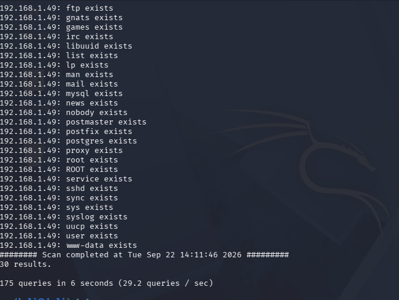
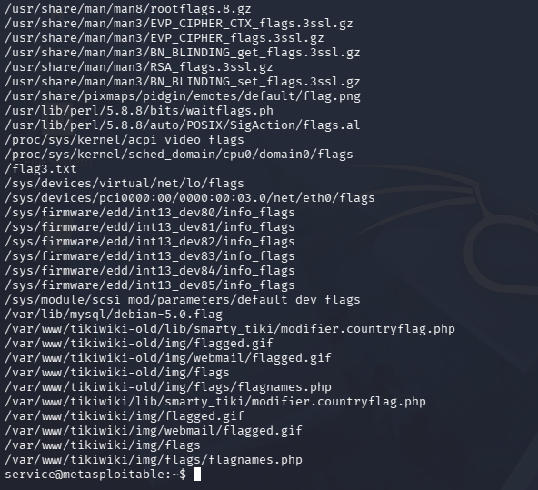

# Caso SMTP: enumeración de usuarios

## Observación

El servidor Postfix SMTP en `25/tcp` respondió de forma diferenciada a consultas `VRFY`. Para identidades conocidas se registró código `252`, y para una identidad inexistente se observó `550`. La enumeración automatizada informó **175 consultas y 30 coincidencias**.

## Interpretación

La diferenciación permite inferir cuentas locales. El código `252` no es prueba universal de existencia en cualquier servidor SMTP; en este caso se interpreta junto con la diferencia de respuestas y el comportamiento de la herramienta. No se observaron accesos no autorizados a las cuentas a partir de esta prueba.

## Riesgo y mitigación

La divulgación de nombres puede facilitar reconocimiento y aumentar la eficacia de intentos posteriores de autenticación. Evaluar necesidad de VRFY, homogeneización de respuestas, monitoreo, límites de consulta y políticas de identidad.

## Evidencias

*Figura 12. Intercambio manual SMTP VRFY. Captura del laboratorio.*

*Figura 15. Resumen de enumeración automatizada. Captura del laboratorio.*

## Estado

**Comportamiento de enumeración observado; compromiso de cuentas no demostrado.**
