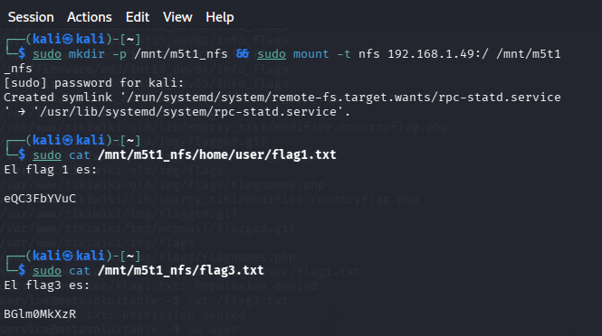

# Caso SSH: acceso válido y algoritmos heredados

## Observación

Se registró acceso SSH con una cuenta del laboratorio, empleando opciones de compatibilidad con `ssh-rsa` y `diffie-hellman-group1-sha1`. La sesión se estableció mediante autenticación con credenciales del ejercicio.

## Interpretación

La necesidad de compatibilidad con algoritmos heredados sugiere una configuración antigua y una oportunidad de endurecimiento. El inicio de sesión mediante credenciales válidas no demuestra una vulnerabilidad de ejecución remota en SSH.

## Mitigación

Inventariar clientes, actualizar servidor y políticas criptográficas, retirar algoritmos heredados según compatibilidad, usar autenticación robusta y registrar accesos.

## Evidencia

*Figura 16. Sesión SSH en el servidor de laboratorio. Captura del laboratorio.*

## Estado

**Acceso válido observado; exposición criptográfica sugerida por opciones de compatibilidad; explotación del protocolo no demostrada.**
