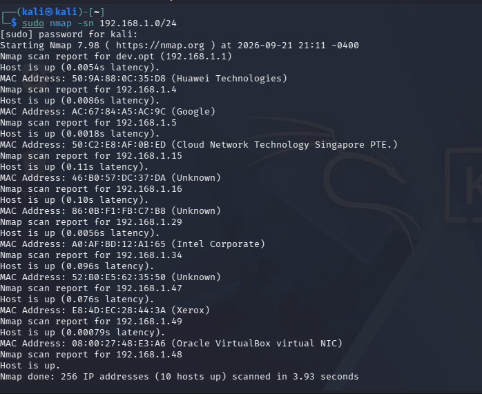
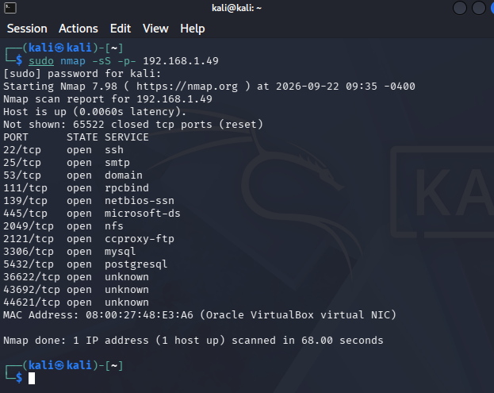
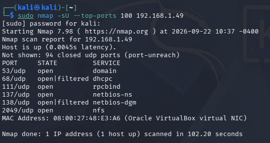
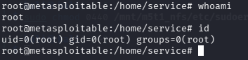

# Caso práctico: servidor Linux en laboratorio

## Escenario

Se estudió un servidor Linux deliberadamente vulnerable desde una estación Kali Linux en red privada. El trabajo avanzó desde la identificación de hosts y servicios hasta la revisión de controles de acceso y observación de una sesión con privilegios elevados.

## Secuencia de observaciones

1. **Descubrimiento:** se identificó `192.168.1.49` como objetivo de laboratorio entre los hosts activos.
2. **Superficie:** se registraron 13 puertos TCP abiertos y respuestas UDP que incluían NFS y RPC.
3. **Servicios:** se detectaron Postfix SMTP, MySQL y NFS; los puertos 21 y 80 aparecieron cerrados.
4. **Identidades:** SMTP VRFY diferenció respuestas para nombres conocidos e inexistentes; la herramienta de enumeración informó 30 coincidencias tras 175 consultas.
5. **Acceso:** se observó inicio de sesión SSH con una cuenta del laboratorio, utilizando compatibilidad con algoritmos heredados.
6. **Archivos:** la exportación NFS del directorio raíz permitió acceder a rutas del sistema desde el cliente del laboratorio; una lectura inicial sin privilegios fue denegada y otra con privilegios locales mostró el contenido de un archivo de prueba.
7. **Base de datos:** se inspeccionó información de autenticación PostgreSQL y posteriormente se documentó lectura de un archivo de prueba mediante el contexto de la base de datos. La documentación conserva **dos contraseñas distintas** atribuidas a la misma cuenta; no se da por resuelta esa discrepancia.
8. **Privilegios:** se observó una consola `root` con UID 0. No queda demostrado de forma inequívoca el vínculo causal entre todos los pasos previos y esa sesión final.

## Evidencias representativas

*Figura 02. Descubrimiento de hosts. Captura del laboratorio.*

*Figura 03. Puertos TCP abiertos. Captura del laboratorio.*

*Figura 04. Estados UDP. Captura del laboratorio.*

*Figura 18. Exportación NFS y lectura de archivo de prueba. Captura del laboratorio.*

*Figura 22. Consola final con UID 0. Captura del laboratorio.*

## Lectura crítica

La secuencia muestra por qué un análisis debe considerar configuraciones e interacciones entre servicios, no solo CVE. La exportación NFS amplia es una condición de alto interés, pero la atribución de todos los efectos posteriores a un único fallo requeriría pruebas aisladas y registro de permisos, configuración y sesión.

## Alcance de la conclusión

El caso demuestra exposición de superficie, enumeración, lectura de recursos y observación de una sesión privilegiada en laboratorio. No demuestra descubrimiento de un 0day, explotación de una vulnerabilidad de memoria ni una remediación ejecutada.
